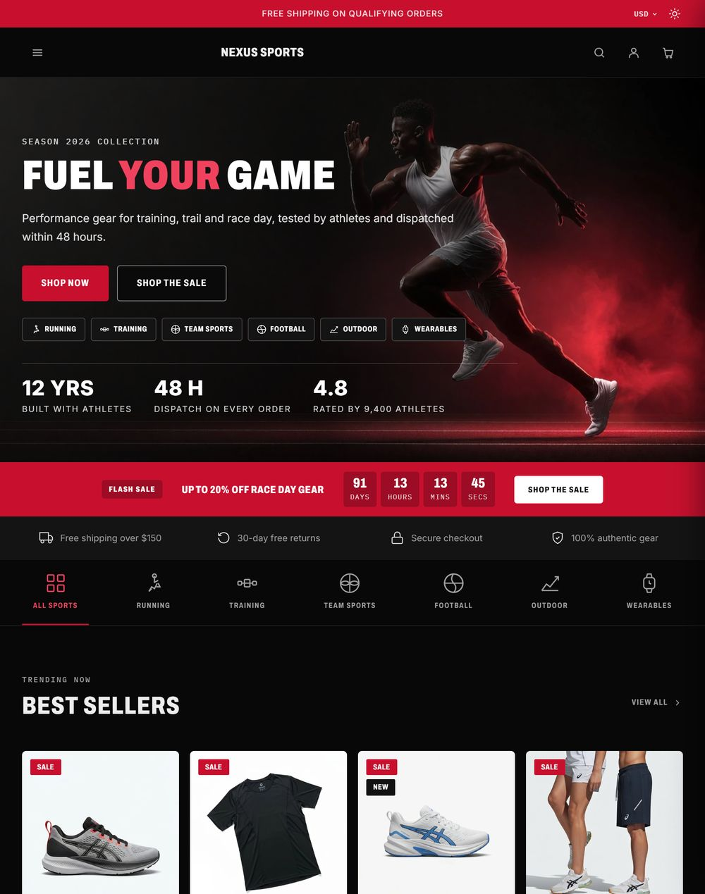

# Nexus Sports theme

Nexus Sports is a BigCommerce Stencil theme for sports, running, outdoor and
training stores. This guide covers everything you need to set it up and run it.

- **Theme:** Nexus Sports 1.0.0, built on Cornerstone 6.21.0
- **Live demo:** <https://nexus-sports-demo.mybigcommerce.com>
- **Support:** <https://papathemes.com/contact-us/> · contact@papathemes.com

{ .shot width="420" }

## What you get

- **Four variations:** Track, Trail, Velo and Flow. Each has its own colours and
  hero panel. See [Choose a variation](usage/choose-variation.md).
- **A homepage built from blocks** that you switch on and off: hero, flash sale
  countdown, trust bar, sport links, featured products, new arrivals, brand strip,
  blog and a shop-the-look photo grid.
- **40 Page Builder regions**, so you can add banners and text without editing
  code. See [Page Builder regions](usage/page-builder.md).
- **Product cards that read your catalog:** sale, sold out, low stock, pre-order
  and your own labels, with no theme setting to maintain.
- **Dark and light mode**, with a switch in the top bar.
- **Mega menu, quick view, cart drawer, list or grid view, product comparison and
  faceted search.**
- **Accessible:** all text meets WCAG 2.1 AA contrast in both colour modes, and
  every control works from the keyboard.

## Where to start

1. [Install and apply the theme](usage/install.md).
2. [Choose a variation](usage/choose-variation.md).
3. [Open Theme Styles](usage/theme-styles.md) and [set up the homepage](usage/homepage.md).
4. Fill the [Page Builder regions](usage/page-builder.md) with your own banners and links.
