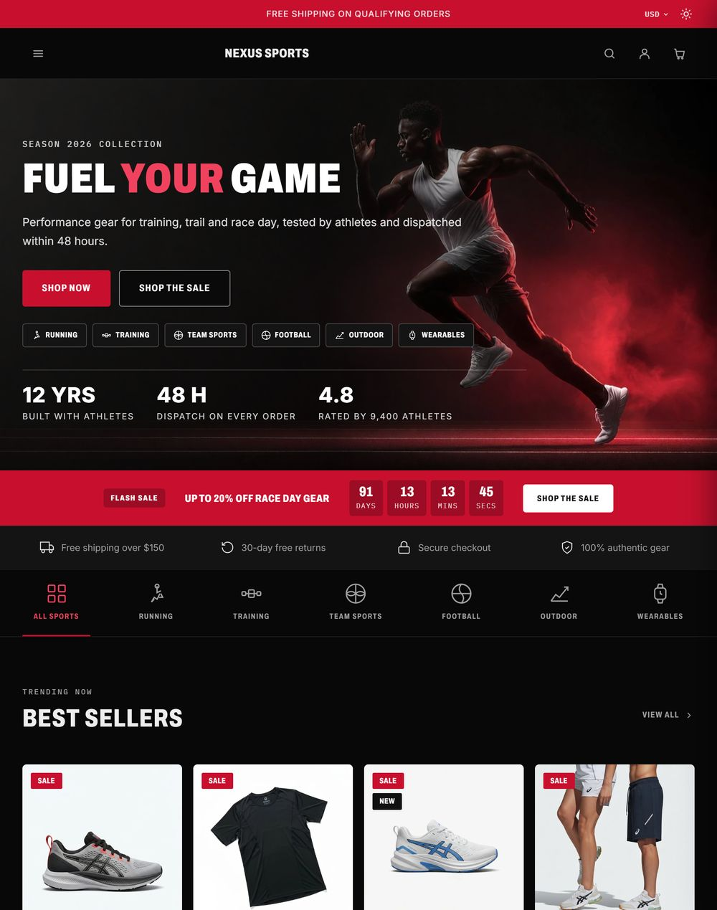
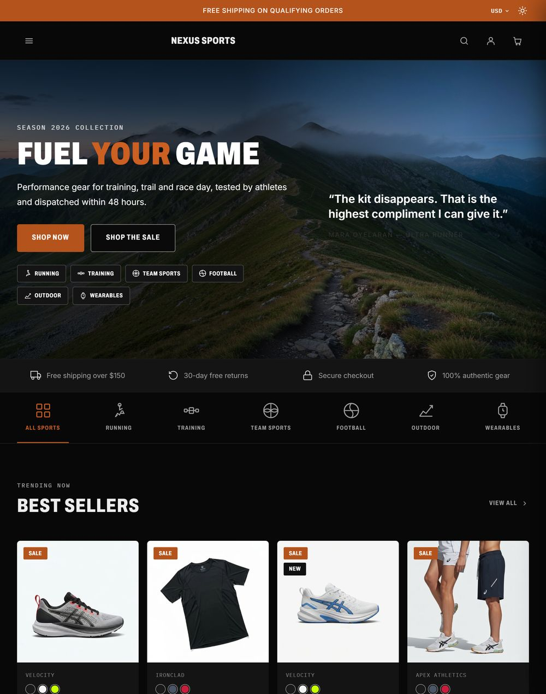
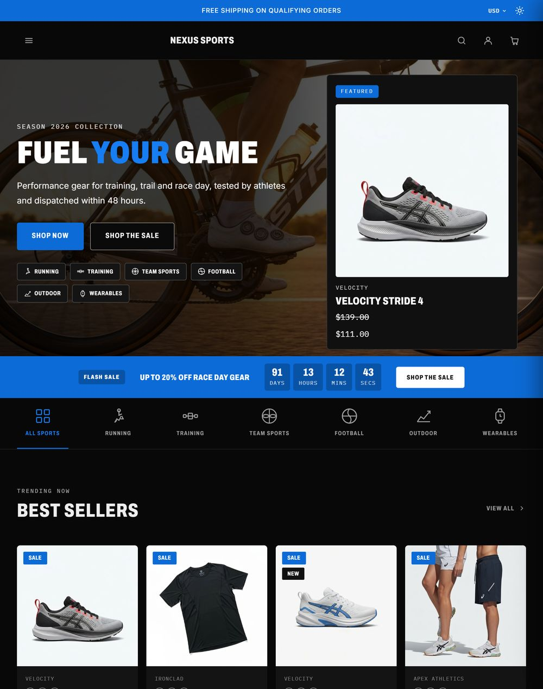
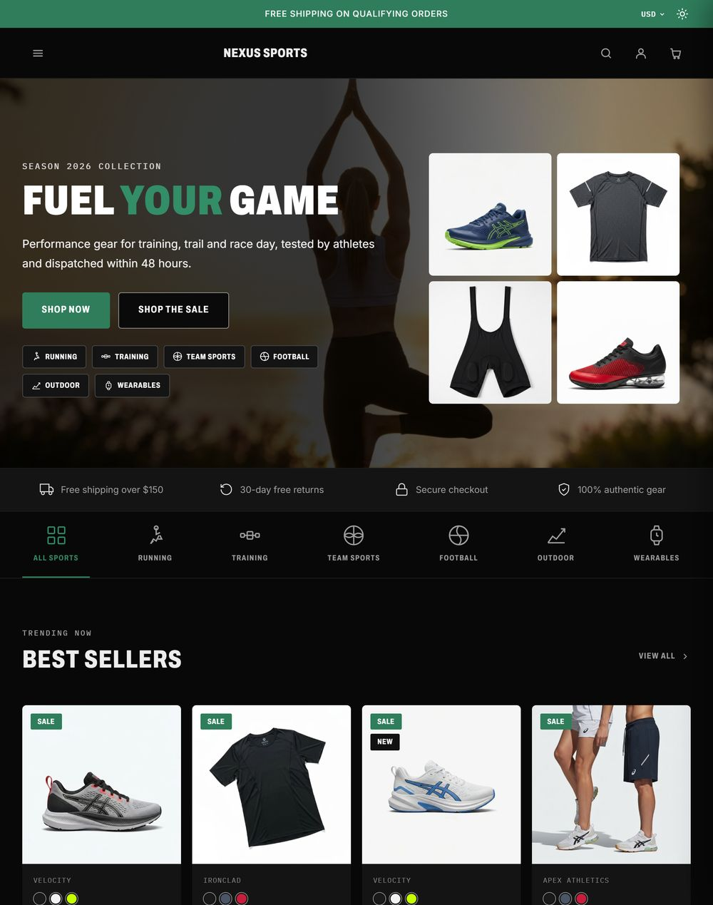

# Choose a variation

A variation is a preset: the same templates with different colours and homepage
choices. You pick one when you apply the theme, and you can switch at any time in
**Theme Styles › Styles** without losing content.

| Variation | Accent | Beside the hero | Off by default | Made for |
|---|---|---|---|---|
| **Nexus Track** | Red `#C8102E` | Three stats | — | Running and training |
| **Nexus Trail** | Burnt orange `#B4531C` | Athlete quote | Flash sale | Outdoor, hiking, trail |
| **Nexus Velo** | Blue `#0C6BD6` | Your first featured product | Trust bar | Cycling, wearables |
| **Nexus Flow** | Green `#2F7D5B` | Photo gallery | Flash sale, brand strip | Yoga, studio, wellness |

{ .shot width="240" }
{ .shot width="240" }
{ .shot width="240" }
{ .shot width="240" }

Everything in the table can be changed after you apply: the accent colour in
**Theme colors**, the hero panel in **Homepage › Hero side panel**, and each
homepage block in **Homepage**.

!!! tip "Switching variations"
    Switching applies that variation's preset values on top of your settings. If
    you have changed colours or homepage blocks, note your values first.
