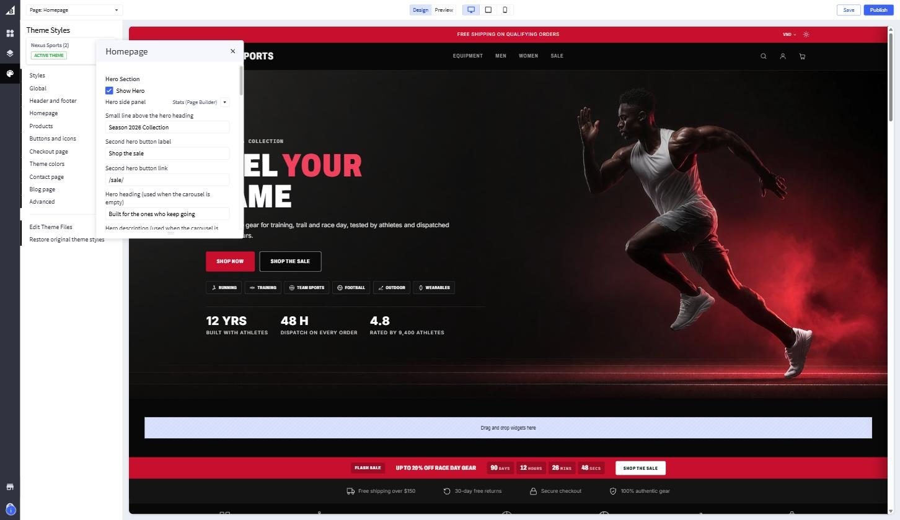

# Theme Styles

Every theme setting lives in **Theme Styles**, inside Page Builder.

1. Go to **Storefront › Themes** and click **Edit in Page Builder** on the
   current theme.
2. Click the **palette icon** in the left bar. Theme Styles opens.
3. Pick a group, change values, and watch the preview update.
4. Click **Save** to keep a draft, or **Publish** to make it live.

{ .shot }

## The groups

| Group | What it holds |
|---|---|
| **Styles** | Switch variation |
| **Global** | Background, text, heading and form colours, page and image options |
| **Header and footer** | Top bar message and link, logo, navigation, social icons, footer |
| **Homepage** | Hero, flash sale, free-shipping bar, section headings, block switches |
| **Products** | Grid columns, brand on cards, sale badges, product page options |
| **Buttons and icons** | Primary, secondary and tertiary button colours |
| **Checkout page** | Colours and fonts of the BigCommerce checkout |
| **Theme colors** | Default colour mode, primary and accent colours, dark-mode palette |
| **Contact page** | Support email, phone and opening hours |
| **Blog page** | Posts per page |
| **Advanced** | Content width, breadcrumbs |

The full list, with the default value of each setting, is in the
[Settings reference](../settings-reference.md).

!!! warning "64-character limit"
    BigCommerce rejects any theme setting longer than 64 characters when the
    theme saves. Keep headings short; put longer text in a Page Builder widget.
